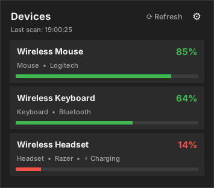
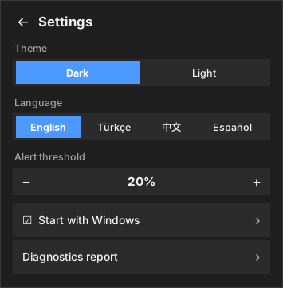

# Battery Monitoring

A small Windows tray app that shows the battery level of your wireless mouse, keyboard and headset in one place. Only a battery icon sits in the taskbar; click it to see every device. When a device drops below your threshold (20% by default), you get a notification.

<p align="center">
  
  
</p>

## Download and install

1. Download `BatteryMonitoring-Setup-<version>.exe` from **[Releases](../../releases/latest)**.
2. Run it. No admin rights are needed; the app is installed for your user account only.
3. The app starts when setup finishes. Its icon may be in the hidden icons area (**^**) at the right end of the taskbar; drag it onto the taskbar to keep it visible.

To try it without installing, the `BatteryMonitoring-<version>-portable.exe` file on the same page runs on its own.

The files are not code-signed, so Windows SmartScreen may show "Windows protected your PC": click **More info → Run anyway**. Every release is built by GitHub Actions straight from this repository, and its SHA256 checksums are in `SHA256SUMS.txt`.

**Uninstall:** Settings → Apps → Installed apps → Battery Monitoring → Uninstall. Your settings stay in `%APPDATA%\BatteryMonitoring`; delete that folder too for a clean removal.

## Supported devices

| Type | How it is read |
|---|---|
| Logitech mice / keyboards (Lightspeed, Unifying or Bolt receiver, or USB cable) | HID++ 2.0 battery features |
| Razer BlackShark V3 family headsets (2.4 GHz dongle) | BlackShark V3 protocol |
| Bluetooth devices | The level Windows itself reports (any device that shows a percentage in Settings → Bluetooth) |

No app can read a Bluetooth device whose percentage Windows does not show. Devices on 2.4 GHz receivers that are not listed above (e.g. many mechanical keyboards) are not supported yet; such a keyboard may still appear when used in Bluetooth mode.

## Features

- The icon shows the level of the lowest device in color (green / amber / red), with a lightning bolt while a device is charging. Hovering it lists all devices.
- **Left click:** the device window. Opening it starts a new scan if the last one is older than 15 seconds. Click outside it or press Esc to close it.
- **Right click:** Show batteries, Quit.
- **⚙** in the window opens the settings: theme (dark / light), language (English, Türkçe, 中文, Español), alert threshold (5–50%), start with Windows, diagnostics report. Changes apply and are saved immediately. On first launch the language follows Windows.
- Scans in the background every 60 seconds. Each device notifies once; the alert re-arms when the device is put on the charger or rises 5 points above the threshold.
- A device that is switched off or asleep stays in the list, greyed out, for 10 minutes.

## Troubleshooting

If a device does not show up, open **⚙ → Diagnostics report**. The `diagnostics.txt` file that opens lists every Logitech/Razer receiver and Bluetooth device the app saw and the result of each read; attach it when reporting a problem. A detailed log is in `%APPDATA%\BatteryMonitoring\log.txt`.

Settings are stored in `%APPDATA%\BatteryMonitoring\settings.json`. Besides the options in the window, these can only be changed in the file (restart the app afterwards):

- `scan_seconds`: scan interval (at least 15).
- `bluetooth` / `logitech` / `razer`: set to `false` to turn a reader off.
- `razer_extra_pids`: product IDs of Razer headset dongles to try even if their name does not contain "BlackShark", e.g. `["057A"]`.

## Development

Requires Python 3.10 or newer.

```
pip install -r requirements.txt
python battery_monitoring.pyw
```

Tests and a local build:

```
pip install -r requirements-dev.txt
python -m pytest -q tests
build.bat
```

`build.bat` builds the app into `dist\BatteryMonitoring\`; if [Inno Setup 6](https://jrsoftware.org/isinfo.php) is installed, it also builds the installer.

`tools/hid_listen.py` listens to an unsupported receiver's collections without sending anything to it, which helps when adding support for a new device.

### Publishing a release

1. Bump `__version__` in `battery_monitoring/__init__.py` (e.g. `0.4.0` → `0.5.0`) and commit.
2. Create and push a tag with the same version:

   ```
   git tag v0.5.0
   git push origin main --tags
   ```

3. GitHub Actions runs the tests, builds the installer and the portable .exe, and publishes the release on the Releases page. The build stops if the tag and `__version__` differ.

Every push to `main` runs the same build; the files can be downloaded from the Actions tab, but no release is created.

## License

MIT. The device protocols are simplified from [Halo Battery](https://github.com/HeyOkay/HaloBattery) (MIT); see [THIRD_PARTY_NOTICES.md](THIRD_PARTY_NOTICES.md).
